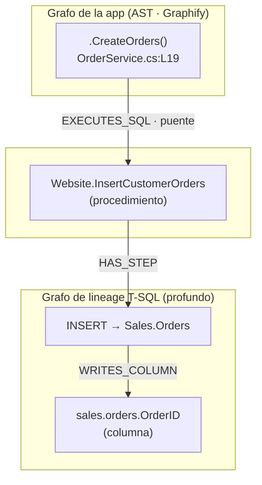

En [[graphify-grafo-navegable|el lab de Graphify]] convertí un repositorio en un grafo que el agente recorre en vez de grepear. En [[tsql-lineage-toolkit|el del toolkit de lineage]] saqué el grafo de dependencias de una base de datos SQL Server a nivel de columna. Cada uno resolvía la mitad de un problema.

Este lab une las dos mitades. Y responde la pregunta que ninguno de los dos podía responder solo:

> Si renombro una columna o cambio un procedimiento, **¿qué código de la aplicación se rompe?**

## El problema: el borde app↔BD

Graphify mapea tu código y también ve tu SQL, pero su extractor de SQL es **superficial**: saca tablas, vistas y funciones, y se detiene ahí. No hay lineage de columnas. El agente ve que existe `sales.orders`, pero no sabe que `CreateOrders()` —un método C#— acaba escribiendo en `sales.orders.OrderID`.

La cadena que conecta una decisión de producto con una columna concreta está rota justo en el sitio donde más duele: **el borde entre la aplicación y la base de datos**. El código llama al SQL a través de un literal de string (`SqlCommand`, Dapper, EF raw), y ahí el grafo se corta.

El toolkit de lineage aporta la profundidad que a Graphify le falta en SQL. Graphify aporta el grafo del código y las operaciones de consulta. La pregunta del lab es: **¿se pueden fusionar sin que ninguno pierda?**

## Modelo mental



Las dos cajas grises ya existían por separado. Lo único que hay que construir es esa arista `EXECUTES_SQL` del medio — y hacer que los IDs de ambos lados se refieran a los mismos nodos.

## Manos a la obra

### 1. Los dos grafos de partida

Del toolkit de lineage, exporta el grafo en formato `graphify-v1` (nodos y aristas planos con `id`, `type`, `size`, `color` — lo que Graphify espera):

```bash
dotnet run -- input.json graph_full.json --columns --nodestore
# graph_full.graphify.json → 1331 nodos, 3223 aristas (con lineage de columna)
```

De la app C#, deja que Graphify la parsee como cualquier repo:

```bash
graphify build ./sample-app        # AST tree-sitter, ~1400 nodos
```

### 2. El adaptador de IDs (la parte con trampa)

Aquí está el detalle que no se ve venir: **los IDs no casan**. El escáner de literales SQL de la app produce aristas puente con un `source` sintético como `app::sample-app/…/OrderService.cs::CreateOrders`, que **no existe** en el grafo AST de Graphify. Graphify nombra ese mismo método `sampleapp_api_services_orderservice_…_createorders`, con etiqueta `.CreateOrders()`.

La tentación es reconstruir el string del ID. Es frágil y se rompe con cualquier genérico (`Task<int>`). La regla robusta es casar por **dos hechos estables**:

> [!tip] Regla de mapeo
> Para cada arista puente, busca el nodo AST cuyo `source_file` termina en la ruta del fichero **y** cuya etiqueta es exactamente `.` + nombre-del-método + `()`. Un solo match ⇒ ese es el `source` real.

Con esa regla, las **6 aristas puente mapearon a un nodo AST real y a un nodo SQL real, sin un solo fallo**. Los `target` (los objetos SQL) ya casaban de fábrica, porque el escáner los cotejó contra el catálogo del toolkit.

### 3. Fusión: a mano, no con `merge-graphs`

El instinto es usar `graphify merge-graphs`. **No lo hagas para este caso.** Su implementación **re-prefija cada ID con una etiqueta de repo** para evitar colisiones entre proyectos — lo cual rompería justo las referencias cruzadas que acabas de alinear. La fusión correcta es una composición manual con networkx que preserva los IDs:

```python
import networkx as nx
from networkx.readwrite import json_graph

app = json_graph.node_link_graph(load("app_graph.json"), edges="links")
sql = json_graph.node_link_graph(load("sql_graph.json"), edges="links")

merged = nx.compose(nx.Graph(app), nx.Graph(sql))   # sin prefijar → IDs estables
for e in aligned_bridge_edges:                        # las 6 aristas puente
    merged.add_edge(e["source"], e["target"], relation="EXECUTES_SQL", **e)
```

> [!warning] Dos escollos de la composición
> Los grafos vienen con **direccionalidad distinta** (el de la app no dirigido, el de SQL dirigido); hay que normalizar antes de `compose` o falla. Y `nx.compose` exige el mismo tipo en ambos.

### 4. El impacto, en un comando

Con el grafo fusionado, la pregunta que abría el lab se responde de una pasada, con fichero y línea:

```bash
graphify affected "WideWorldImporters::Website.InsertCustomerOrders" \
    --relation EXECUTES_SQL --depth 2
```

```
→ .CreateOrders()  [EXECUTES_SQL]  SampleApp.Api/Services/OrderService.cs:L19
```

De un procedimiento SQL a los métodos de aplicación afectados. Eso es el análisis de impacto inverso que ninguna de las dos herramientas daba por separado.

## Los números reales

No es un ejemplo de README. Esto salió de fusionar la base de prueba **WideWorldImporters** con una app C# de muestra.

| Métrica | Valor |
|---|---|
| Nodos en el grafo fusionado | 2.739 |
| Aristas | 6.168 (3.127 app · 3.035 SQL · 6 puente) |
| Aristas puente alineadas | **6 / 6**, 0 fallos |
| Camino verificado | método C# → proc → paso → columna |

El trazado concreto que queda navegable en el grafo:

```
.CreateOrders() [OrderService.cs]
  ──EXECUTES_SQL (puente)──▶ Website.InsertCustomerOrders (Process)
  ──HAS_STEP──▶ paso "INSERT → Sales.Orders"
  ──WRITES_COLUMN──▶ WideWorldImporters:table:sales.orders:column:OrderID
```

## Lo que no funcionó (y por qué lo cuento)

La hipótesis era bonita: si vuelvo a **agrupar el grafo fusionado en comunidades**, las tablas de Ventas y el código que las llama deberían caer en la misma comunidad, y ahí tendría el acoplamiento app↔BD dibujado solo.

No pasó.

> [!failure] Hallazgo negativo · 0 de 6
> Ninguna de las 6 aristas puente puso al método C# en la misma comunidad que su objeto SQL. `.CreateOrders()` cayó en la comunidad 32; su `Website.InsertCustomerOrders`, en la 15.

La razón es estructural: **seis aristas cross-dominio no mueven el óptimo de modularidad contra ~6.100 aristas intra-dominio**. Cada lado es demasiado denso por dentro. El clustering sí da una vista macro excelente *dentro* de cada dominio —`sales.orders` y sus 16 columnas caen juntas al 100%— pero no es la herramienta para el borde. Para el borde, la superficie fiable es la **traversal explícita del puente**, no las comunidades.

(Nota: corrió Louvain, no Leiden — `graspologic` no estaba instalado. El hallazgo es estructural y no cambiaría con Leiden.)

Publicar el resultado negativo no es autocrítica: es lo que separa un análisis reproducible de una demo de humo.

## El método detrás del lab

El PoC no se construyó a mano de un tirón, sino como una **orquestación multi-agente** deliberada —el mismo enfoque de *pídele al modelo que piense antes de que genere* y de [[harness-engineering-agentes-ia]]—: cada tarea calificada por complejidad y asignada al modelo adecuado, con un *gate* como disparador de escalado.

| Rol | Modelo | Trabajo |
|---|---|---|
| Arquitecto | Opus | Plan, regla de mapeo de IDs, definición del gate |
| Ejecutor | Sonnet | Adaptador, fusión, gate de conectividad, clustering |
| Documentalista | Haiku | Informe a partir de hechos ya verificados |

El gate de conectividad era la condición de escalado: si Sonnet no encontraba el camino método→columna, la parte difícil subía a Opus. **No hizo falta** — Sonnet lo resolvió e incluso corrigió por su cuenta el choque dirigido/no-dirigido. Se usó la capacidad cara solo donde había evidencia de necesitarla, no por si acaso.

## De PoC a producto

El lab demuestra la ruta. El producto es un **extractor SQL de primera clase para Graphify**: sustituir su `sql.py` superficial por el extractor `graphify-v1` profundo, con dos piezas que el PoC dejó identificadas —de-duplicar los nodos "concepto" superficiales por etiqueta, y normalizar el atributo de relación para que el impacto filtrado funcione en todo el grafo—. Ese es el siguiente paso.

## Aplícalo

¿Tienes tu propia app y tu propia base SQL Server? Pégale esto a tu agente de código — leerá el post y repetirá el método sobre tu repo, no sobre el de este lab.

```text
Con mi consentimiento, aplica el método de este lab a mi app y mi base
SQL Server: exporta mi grafo de lineage en formato graphify-v1 (--columns
--nodestore) y el grafo AST de mi app con Graphify. No inventes cadena de
conexión ni credenciales — pídemelas o usa las que ya tenga configuradas.
Mapea las aristas puente del escáner SQL a mis nodos AST reales por
fichero + nombre de método (nunca reconstruyendo el string del ID).
Fusiona los dos grafos a mano con networkx, no con merge-graphs —rompe
los IDs que acabas de alinear—, y enséñame con `graphify affected` qué
código mío se rompe si cambio el procedimiento SQL que te indique.
```

---

*Pieza interactiva que acompaña este lab (diagrama del trazado y el método): [Deep SQL for Graphify](https://claude.ai/code/artifact/c3234049-de61-4ae7-940e-0f9aab207ea2).*
