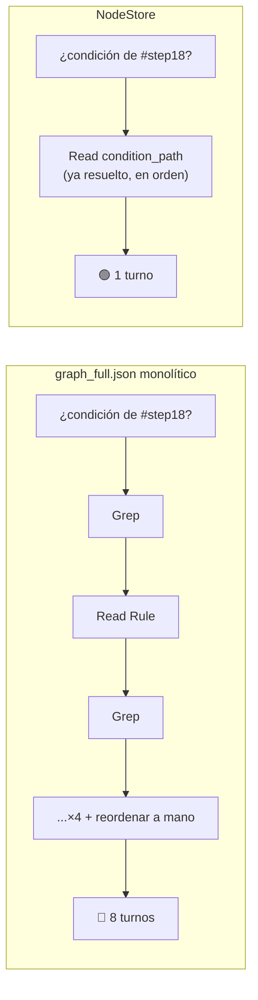

Pasé semanas optimizando un formato de datos para que un agente de IA lo leyera mejor. Lo medí con un script en Node: menos bytes, menos milisegundos, todo a favor. Cuando por fin lo medí con un agente de verdad, en uno de los casos la ventaja no existía. En otro, se invertía: el formato "optimizado" hacía que el agente leyera *más*.

El error no estaba en el dato. Estaba en lo que usé para medirlo.

## El error de medir con un script cuando el consumidor es un agente

El proyecto es un `NodeStore`: en vez de entregarle a un agente un grafo de lineage SQL monolítico (`graph_full.json`, cientos de KB, miles de relaciones), lo particiono en ficheros por objeto — cada tabla, cada procedimiento, con sus aristas ya resueltas.

La primera batería de pruebas la hice con un script Node: `process.hrtime.bigint()`, `process.memoryUsage()`, bytes leídos, milisegundos. Y los números salían bien — 16x menos datos en un caso, 6.5x más rápido en otro. Documentación pulida, gráficas convincentes.

Pero un script no es el consumidor real de este dato. El consumidor es un agente de IA leyendo con `Read` y `Grep`, razonando entre cada llamada. Y para un agente, lo que cuesta caro no son los milisegundos de E/S — es el **número de turnos de herramienta**: cada uno es una ronda completa de razonar, llamar, esperar. Medir con Node cuando el consumidor real es un agente da una imagen equivocada de la ventaja.

> [!warning] La métrica depende de quién consume el dato
> Para un script, lo que se mueve es tiempo de E/S y memoria. Para un agente, lo que de verdad cuesta es el número de turnos. Son ejes distintos y pueden no moverse en la misma dirección.

## La disciplina: subagentes ciegos, sin memoria de la conversación

Cuando decidí medir con un agente en vez de con Node, cometí un segundo error antes de corregirlo: repetí la prueba yo mismo, con el mismo asistente que había escrito el propio documento de análisis.

El resultado salió artificialmente bueno. Y por una razón obvia en retrospectiva: yo ya tenía en el contexto de la conversación los IDs exactos de la cadena que estaba "buscando" (`919e0771`, `6a6b8490`, `ca699726`, `4161cf00`) porque los había escrito yo mismo unas líneas antes en ese mismo fichero. Lo que parecían "9 saltos de descubrimiento" eran en realidad grep de *confirmación* sobre algo que ya sabía.

La única medición válida es con **subagentes aislados, lanzados sin memoria de la conversación**, cada uno con una única instrucción ("encuentra la cadena de condiciones de `#step18` en este fichero, sin conocimiento previo de su contenido") y acceso solo al fichero correspondiente. Nada de contexto compartido, nada de atajos. Así es como se mide de verdad el comportamiento de un agente frente a un dato: como si fuera la primera vez que lo ve, porque para el agente real que use esto en producción, siempre lo es.

Con esa disciplina, el primer resultado limpio (Caso 2 del análisis) fue contundente: **8 turnos de herramienta contra 1** para responder "¿bajo qué condiciones se ejecuta este paso?" — el agente que tenía el grafo monolítico tuvo que encadenar `Grep`/`Read` cuatro veces (una por cada nodo `Rule` anidado) y luego invertir el orden a mano; el agente con el NodeStore leyó un único campo (`condition_path`) ya resuelto en el orden correcto. Tiempo y memoria reales fueron modestos (~1.3-1.7x) — el ahorro estaba en los turnos, no en la E/S.

## El negativo honesto: cuando el NodeStore no ayudaba

Con la misma disciplina de subagentes ciegos, repetí el experimento con una pregunta distinta: reconstruir una cadena de llamadas `EXEC` de 4 niveles (`Configuration_ApplyDataLoadSimulationProcedures` → ... → 2 procedimientos más, en WideWorldImporters).

El resultado no confirmó la tesis. Lo contradijo.

| | Tool calls | Líneas leídas |
|---|---|---|
| A) `graph_full.json` completo | ~6-9 | ~1800-2000 |
| B) NodeStore | ~6-7 | **~3600** |

Turnos prácticamente iguales entre las dos vías, y el NodeStore leyendo **más** líneas, no menos. El motivo: cada salto de la cadena obligaba a abrir un `object.json` completo — y cada uno pesaba hasta 145 KB porque incluía *todos* los pasos y variables del procedimiento, no solo la arista `CALLS` que hacía falta. Un agente real lee el fichero entero en vez de extraer el campo relevante; el JSON monolítico, en cambio, se beneficiaba de un grep amplio que traía varias aristas de golpe sin abrir ficheros nuevos.

> [!failure] Caso 4: sin ventaja
> El NodeStore ganaba 8x en turnos cuando la respuesta vivía en un único objeto. En una cadena de varios objetos, esa ventaja se diluía o se invertía — porque cada salto reabría un fichero completo en vez de seguir solo el puntero que hacía falta.

Publiqué ese resultado tal cual, con la tabla y el motivo, en el mismo documento donde había presumido del 8x. No tiene sentido quedarse solo con la cifra que confirma la hipótesis y callar la que no.

## El fix: `nav.json` por objeto, y la re-medición que revierte la conclusión

El propio análisis ya dejaba escrita la implicación de diseño antes de implementarla: si el objetivo es que un agente resuelva cadenas de llamadas con el mismo ahorro que ya tenía la condición de un step, hace falta un fichero por objeto que contenga *solo* las aristas de navegación (`CALLS`/`WRITES_TO`/`READS_FROM`/`AFFECTS`/`FK_TO`) — no el objeto entero.

Así nació `nav.json`: junto a cada `object.json`, un fichero pequeño con únicamente esas ~19-35 aristas de navegación (de las ~70-100 que puede tener un objeto grande), cada una apuntando ya al `nav.json` del vecino en vez de a su `object.json` completo. Una cadena de saltos se queda en ficheros de pocos KB en lugar de reabrir el procedimiento entero en cada hop.

Repetí exactamente el mismo experimento del Caso 4 — misma pregunta, misma disciplina de subagentes ciegos sin memoria de la conversación — pero esta vez a un agente se le prohibió explícitamente abrir `nav.json` (solo `object.json`) y al otro se le prohibió abrir `object.json` (solo `nav.json`):

| | Tool calls | Líneas leídas | Tokens del subagente | Duración |
|---|---|---|---|---|
| A) solo `object.json` | 11 | ~3290 | 94 521 | 65.4 s |
| B) solo `nav.json` | **8** | **~1256** | **47 826** | **35.5 s** |
| Mejora | 1.4x menos | **2.6x menos** | **2.0x menos** | 1.8x más rápido |

Ambos agentes reconstruyeron la misma cadena correcta. El agente A llegó a truncar la lectura del `object.json` de 145 KB de uno de los procedimientos intermedios; el agente B, saltando `nav.json` → `nav.json`, leyó del orden de 427 líneas por loop en vez de miles.

> [!tip] El agujero se cierra sin tocar lo que ya ganaba
> 2.6x menos líneas, 2.0x menos tokens, 1.8x más rápido. Esto revierte la conclusión del Caso 4 sin tocar los casos que ya ganaban (condición de un step, actualización incremental, integridad de datos).

La misma disciplina de medición que había revelado el negativo fue la que confirmó que el fix funcionaba. No hubo atajo: hubo que volver a montar el mismo experimento ciego, con la misma vara.

## La lección meta: documentar mejor el dato no sustituye a instruir mejor al agente

Antes de construir `nav.json`, probé algo más barato: verificar si de verdad faltaba un dato, o si solo faltaba *documentar una garantía* que ya existía. Resultó que `model.json` ya consolidaba todo lo necesario (llamadas estáticas y efectos de SQL dinámico, deduplicados a escala objeto↔tabla) — lo que faltaba era que `index.json.howto` lo dijera explícitamente. Añadí esa garantía al esquema (`completeness`, `exec_resolution`) y repetí el test ciego.

Sin mejora. Mismo agente, misma pregunta, garantía ya declarada por escrito: **9 tool calls, ~3500 líneas — igual que antes, incluso ligeramente peor**. El agente leyó y citó textualmente la garantía ("let me verify this is complete by cross-checking the model.json...") y aun así volvió a abrir cada `object.json` uno por uno "para confirmarlo".

Ese fue el hallazgo que más me hizo reajustar cómo pienso el problema. No era un problema de datos incompletos, ni de un esquema mal documentado — era un patrón de comportamiento del agente: ante una tarea enmarcada como "encuentra la cadena **completa**", verifica por las dos vías disponibles aunque una ya le baste, sin que ningún texto en el propio fichero pueda evitarlo. Documentar mejor el dato no sustituye a instruir mejor al agente — o a aceptar ese coste de verificación como inherente a las tareas que exigen certeza, no solo una respuesta plausible.

## Cierre

Tres cosas se quedaron después de este ciclo. Una: el NodeStore no es uniformemente mejor, depende de la forma de la pregunta — gana claro cuando la respuesta vive en un objeto, se diluye cuando obliga a recorrer varios en cadena, y ahí hay que diseñar un atajo específico (`nav.json`), no forzar el mismo formato a servir para todo. Dos: la métrica que importa depende de quién consume el dato, y para un agente eso son turnos, no microsegundos. Tres: un negativo medido con disciplina vale más que un positivo medido a ojo — y solo se sabe si un fix funciona volviendo a montar el mismo experimento ciego que destapó el problema.

Esto es la misma disciplina que ya defendí en [[harness-engineering-agentes-ia]] y en [[datos-navegables-para-agentes]]: el harness no es el modelo, es la infraestructura de medición y retroalimentación alrededor de él. Y conecta directo con [[ratchet-efecto-memoria-agente]] — la corrección de este ciclo (el `nav.json`, la garantía de completitud en el `howto`) queda documentada para no tener que redescubrirla la próxima vez. La confiabilidad de un sistema con IA no viene de que el modelo sea mejor cada versión; viene de que existan gates y fuentes de verdad —como estos subagentes ciegos— que te digan la verdad aunque no sea la que esperabas. Sobre eso trata [[confiabilidad-no-viene-del-modelo]].

---

*El toolkit y el análisis completo (Casos 1-7, con los scripts de medición) están en [github.com/rcm-on/tsql-lineage-toolkit](https://github.com/rcm-on/tsql-lineage-toolkit).*
